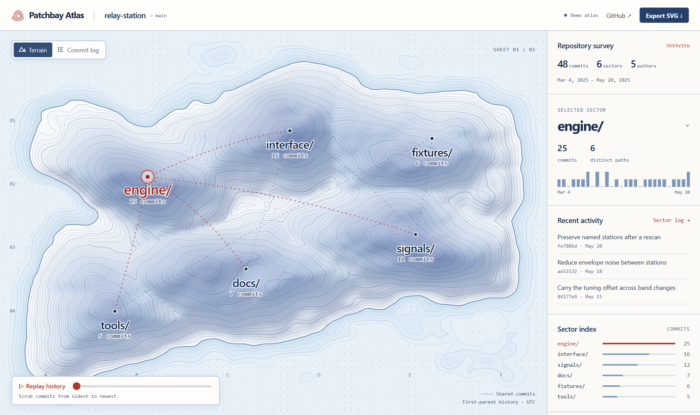

# Patchbay Atlas

Turn the last few months of a Git repository into a topographic map. Peaks represent directories, routes connect directories that change together, and the replay controls let you step through the history one commit at a time.

[Explore the live demo](https://saimeeee.github.io/patchbay-atlas/) · [Download the CLI](https://github.com/saimeeee/patchbay-atlas/releases/latest/download/patchbay-atlas.pyz) · [简体中文](README.zh-CN.md)

[](https://saimeeee.github.io/patchbay-atlas/)

## Map your own repository

You need **Python 3.9+** and **Git 2.31+**. Download the single-file CLI from the link above, then run:

```sh
python patchbay-atlas.pyz /path/to/repository -o my-atlas.html
```

Open `my-atlas.html` in a browser. The report contains the history, renderer and controls in one file. It works offline and can be sent to a teammate or hosted as a static page. On systems where Python is named `python3`, use that command instead.

From a source checkout:

```sh
git clone https://github.com/saimeeee/patchbay-atlas.git
cd patchbay-atlas
python atlas.py /path/to/repository -n 500 -o my-atlas.html
```

| Option | Meaning |
| --- | --- |
| `repository` | A repository, a directory inside one, or a bare repository. Defaults to the current directory. |
| `-n`, `--limit` | Maximum number of first-parent commits, starting at HEAD. Defaults to 250. |
| `-o`, `--output` | HTML destination. Defaults to `atlas.html`. |
| `-f`, `--force` | Replace an existing output file. |

## Read the map

- **Terrain** charts top-level directories in sheets of six, ordered by commit count. Root-level files share the `/ (root)` sector. Labels give the exact counts. Terrain is a schematic illustration of activity.
- **Shared routes** mark directories touched by the same commit. Each sheet draws up to eight of its strongest connections.
- **Sector inspector** shows distinct paths, activity over the survey period and recent commits. Select a summit, index entry or directory in the selector.
- **History replay** walks the first-parent chain from oldest to newest. Press play or scrub to any commit to highlight its sectors. Click the current commit's subject to inspect its file changes.
- **Commit log** searches subjects, authors, hashes and paths. Each commit inspector includes its UTC date, changed paths and added/deleted line counts. Binary changes carry a separate label.
- **Export SVG** downloads the current sheet, including the selected replay frame, as a standalone graphic. To put it in a README, commit the file and add an image reference such as ``.

## What goes into a report?

The CLI reads the first-parent chain of the checked-out HEAD. A merge contributes the change against its first parent. Every changed top-level directory gets one touch per commit, so sector counts can sum above the repository total. Renames appear as removed and added paths. Commit times are displayed in UTC.

Everything runs on your machine. The exported HTML contains repository and branch names, author names, commit subjects and IDs, file paths, and line counts. Source contents, patches and author emails are excluded. Review the report before publishing private repository metadata.

The hosted **relay-station** demo is a fictional audio project with 48 hand-written commit subjects and deterministic synthetic changes. Its full source lives in [tools/build_demo.py](tools/build_demo.py).

## Development

The CLI and generator use the Python standard library. The map, timeline and SVG exporter use native browser APIs.

```sh
python -m unittest discover -s tests -v
python tools/build_demo.py
python tools/build_zipapp.py patchbay-atlas.pyz
```

`atlas.template.html` is the shared renderer for the static demo and every exported report. Regenerate `index.html` after changing the renderer or demo history.

Released under the [MIT License](LICENSE).
