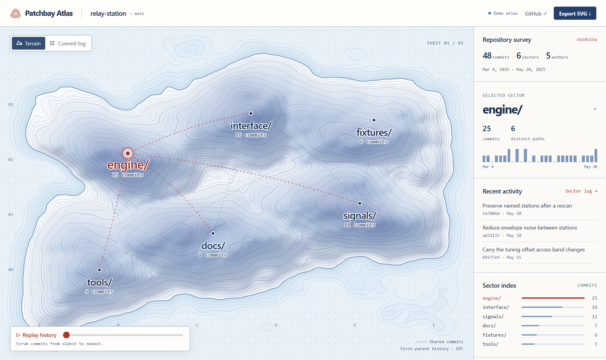

# Patchbay Atlas

把一个 Git 仓库的提交历史画成地形图。点开一处地形，可以看到这个目录最近发生了什么。沿时间轴回放，则能看到一次改动跨过了哪些目录。

[探索在线示例](https://saimeeee.github.io/patchbay-atlas/) · [下载单文件命令行工具](https://github.com/saimeeee/patchbay-atlas/releases/latest/download/patchbay-atlas.pyz) · [English](README.md)

[](https://saimeeee.github.io/patchbay-atlas/)

## 给自己的仓库画一张图

准备 Python 3.9 或更高版本以及 Git，下载上面的 `patchbay-atlas.pyz`。例如，工具与 `my-project` 文件夹位于同一目录时，运行以下命令。

```sh
python patchbay-atlas.pyz ./my-project -o my-atlas.html
```

双击生成的 `my-atlas.html` 即可探索。它把地图、提交数据和交互代码都放在这一个文件里。你也可以导出当前图幅的 SVG，嵌入项目 README。

## 怎么读图

- **目录**对应地图上的区域。标签显示该目录在本次采样中涉及多少条提交，虚线连接同一批提交中一起变化的目录。
- **回放**让你从旧到新浏览提交，观察同一次改动涉及的区域，再打开该提交查看摘要和文件变动。
- **提交日志**可以按摘要、作者、哈希或路径搜索。点选目录后，还可以只看与这个目录有关的改动。

默认从 `HEAD` 沿第一父提交链读取最多 250 条记录。可以用 `-n 500` 调大范围。输出文件已存在时，换一个文件名，或加 `--force` 覆盖。

在线示例使用一套虚构的无线电项目历史。处理真实仓库时，命令在本机读取 Git。生成的报告包含作者姓名、提交摘要和文件路径，分享 HTML 时这些内容也会随文件一起发出。

## 从源码运行

```sh
python atlas.py /path/to/repo -o atlas.html
python -m unittest discover -s tests -v
```

[MIT 许可证](LICENSE)
